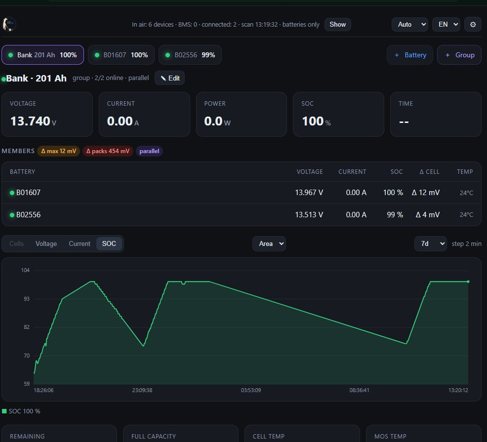

# power-peasant

Unofficial monitor for Power Queen LiFePO4 SMART batteries: per-cell voltages, current,
power, SOC, temperature, charge/discharge time, groups and charts. The BMS is read
directly over Bluetooth.

No cloud, No phone, No account. Free.



**Read in:** [English](docs/en-README.md) · [Українська](docs/uk-README.md)

## Windows Installation
Windows users can download the portable build exe from
[Releases](https://github.com/moleculafree/power-peasant/releases) (Windows 10/11 x64).


## Quick start from sources (linux/windows)

```bash
git clone https://github.com/moleculafree/power-peasant
cd power-peasant
python3 -m venv .venv && source .venv/bin/activate   # Windows: .venv\Scripts\activate
pip install -r requirements.txt
python scripts/pq_monitor.py
```

Open **http://127.0.0.1:8791/**


## Documentation

- [English manual](docs/en-README.md)
- [Українська інструкція](docs/uk-README.md)
- [Documentation index](docs/README.md)
