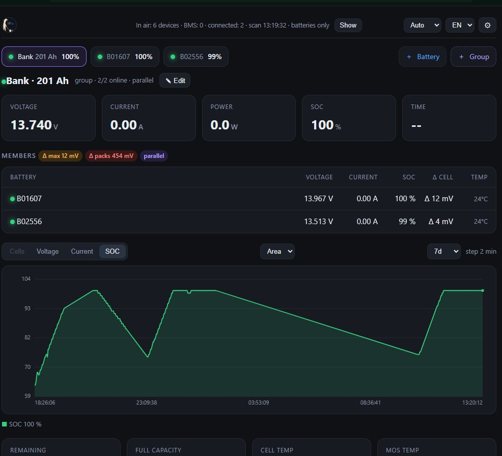

# Power Peasant — Power Queen battery monitor

Unofficial monitor for Power Queen LiFePO4 SMART batteries. It shows per-cell voltages —
the data the official app parses but never displays — plus current, power, SOC,
temperature, charge/discharge time, groups and charts.

The monitor talks to the BMS directly over Bluetooth LE and only sends the `Inquire`
request (`0x13`); no control commands are used.



## Features

- per-cell voltages with the highest/lowest cell highlighted, delta and balancing state;
- live voltage, current, power, SOC, SOH, temperatures and time to empty/full;
- groups of batteries (parallel or series) with aggregated values and capacity;
- charts in five styles (line, area, step, bars, dots) backed by CSV history;
  windows 5m–2y plus All (whole log period, downsampled with a step label);
- scan list with discovery history, manual add/remove and a batteries-only filter;
- settings in `assets/config.json` or via the ⚙ dialog;
- Bluetooth status banner (off / no adapter) and an About dialog with logo, version
  and sponsor links from `.github/FUNDING.yml`;
- theme switcher: auto (follows the OS), dark or light;
- UI in Ukrainian, English and German (English by default); no phone or cloud required.

## Requirements

- Python **3.10+** (tested with 3.13)
- Bluetooth LE adapter (Windows 10/11, Linux with BlueZ)
- Windows binaries target **Windows 10/11 x64** (Windows 7 is not supported)
- `pip install -r requirements.txt` (`bleak`, `pywebview`)

### Linux prerequisites

```bash
sudo apt update
sudo apt install -y python3-venv python3-pip bluez
```

## Install

```bash
git clone https://github.com/moleculafree/power-peasant
cd power-peasant
python3 -m venv .venv
```

Activate the environment:

```powershell
# Windows
.venv\Scripts\activate
```

```bash
# Linux / macOS
source .venv/bin/activate
```

```bash
pip install --upgrade pip
pip install -r requirements.txt
```

## Run and stop

### Windows (PowerShell)

```powershell
.\scripts\run.ps1 start            # background, prints the URL
.\scripts\run.ps1 start -Port 8800
.\scripts\run.ps1 start -BindHost 0.0.0.0   # reachable from LAN (no auth!)
.\scripts\run.ps1 status
.\scripts\run.ps1 logs -Follow
.\scripts\run.ps1 restart
.\scripts\run.ps1 stop
.\scripts\run.ps1 foreground       # runs in this console, Ctrl+C to stop
```

If PowerShell blocks scripts, use the batch wrapper:

```powershell
.\scripts\run.cmd start
.\scripts\run.cmd status
.\scripts\run.cmd stop
```

### Linux / macOS

```bash
chmod +x scripts/run.sh
./scripts/run.sh start
./scripts/run.sh start --port 8800
./scripts/run.sh start --host 0.0.0.0     # reachable from LAN (no auth!)
./scripts/run.sh status
./scripts/run.sh logs --follow
./scripts/run.sh stop
./scripts/run.sh foreground
```

### Direct run

```bash
python scripts/pq_monitor.py --port 8791
python scripts/pq_monitor.py --window          # embedded window
python scripts/pq_monitor.py --host 0.0.0.0    # LAN access (no auth)
```

Open **http://127.0.0.1:8791/**

> The server listens on `127.0.0.1` only by default. With `--host 0.0.0.0`
> (or `-BindHost 0.0.0.0` on Windows) it is reachable from other machines —
> there is **no authentication**, so use it only on a trusted network.

## What it shows

- pack voltage, current, power, SOC;
- estimated time to empty/full — a single value based on the absolute current;
- per-cell voltages (mV and V), delta max−min, balancing state;
- the highest cell is green, the lowest is orange, a critically low cell (<3.05 V) is red;
- for groups: pack spread between members;
- remaining/full capacity, SOH, cycles, discharged Ah;
- cell and MOSFET temperatures, BMS protection/fault flags.

## Scan and devices

The scan dialog shows the latest radio scan (every 20 s): name, MAC, RSSI, BMS flag,
and a history of devices seen earlier. From there you can connect a new battery
immediately, clear the history, or enable the **batteries only** filter.

Known batteries can be removed from monitoring with **✕ Remove** on their page. The name
is stored in `data/ignored.json`, so auto-discovery will not add it again; CSV history is
kept. Return it via the scan list or the **＋ Battery** button.

## Groups

- the name is free text (**✎ Edit**);
- capacity is added automatically from the connected members (BMS FCC), and updated when
  a battery disappears (`100 / 201 Ah`);
- parallel: voltage is averaged, current and capacity are summed;
- series: voltage is summed, current/capacity follow the weakest battery;
- group SOC is capacity-weighted: `Σ remaining / Σ FCC`.

## Settings

`assets/config.json` can be edited manually or with the ⚙ button (changes apply
immediately; a manual edit needs a page reload).

| Key | Meaning |
|---|---|
| `ui.colors.cellMax` / `cellMin` / `cellNormal` / `cellCritical` | cell colors |
| `ui.colors.chartPalette` | chart line colors |
| `ui.cells.scaleMinV` / `scaleMaxV` | cell bar scale |
| `ui.cells.criticalMv` | critically low threshold, mV |
| `ui.thresholds.cellDeltaOkMv` / `cellDeltaWarnMv` | cell delta thresholds |
| `ui.thresholds.packSpreadOkMv` / `packSpreadBadMv` | group pack-spread thresholds |
| `ui.chart.defaultWindowSec` | default chart window, s (0 = all) |
| `ui.scan.onlyBatteries` | “show only batteries” in the scan dialog |
| `server.pollIntervalSec` | BLE poll interval (after restart) |
| `server.logIntervalSec` | CSV row interval (after restart) |
| `server.historyHours` | history preloaded on start |
| `ui.about.repo` | GitHub link in the About dialog |
| `ui.about.donate` | extra donation link (FUNDING.yml links are shown anyway) |

Invalid values fall back to defaults; colors must be `#rgb` / `#rrggbb`.
CLI options (`--interval`, `--log-interval`, `--history-hours`) override `server.*`.

## Structure

```
scripts/pq_monitor.py    # BLE polling + HTTP server
assets/ui/               # dashboard (HTML/JS/CSS), served from disk
assets/config.json       # settings
data/                    # CSV history, groups, scan history, logs (gitignored)
packaging/               # Windows build: spec, icon, build.ps1, BUILD.md
docs/                    # documentation, screenshots
tests/                   # unittest suite: protocol, config, groups, FUNDING.yml
```

## Tests

```bash
python -m unittest discover -s tests
```

They cover protocol frames, config merging/clamping, group aggregation, funding
parsing and version metadata.

## Windows app

Prebuilt portable builds are on the
[Releases](https://github.com/moleculafree/power-peasant/releases) page: download
`PowerPeasant-<version>-win64.exe`, run it, choose the target folder, then start
`PowerPeasant.exe` inside. Building from source: [packaging/BUILD.md](../packaging/BUILD.md).


## How it works

- PID `data/monitor.pid`; logs `data/monitor.log` (rotated to `.prev` on Windows starts);
- scripts stop only `pq_monitor.py` processes;
- one BLE connection per battery: the phone app cannot be connected at the same time;
- if `8791` is busy with a different kind of instance (source vs packaged), the app
  starts on the next free port instead of attaching to it; same-kind instances share
  one window;
- history lives in monthly `data/<name>-YYYY-MM.csv` files (new month = new file);
  older single-file `data/<name>.csv` logs are imported once on first start and
  renamed to `*.csv.imported`; the last CSV column `balance` lists balancing cells
  (e.g. `1 3`).

## More

- [BLE protocol reference](protocol.md)
- [Documentation index](README.md)
- [Main README](../README.md)
