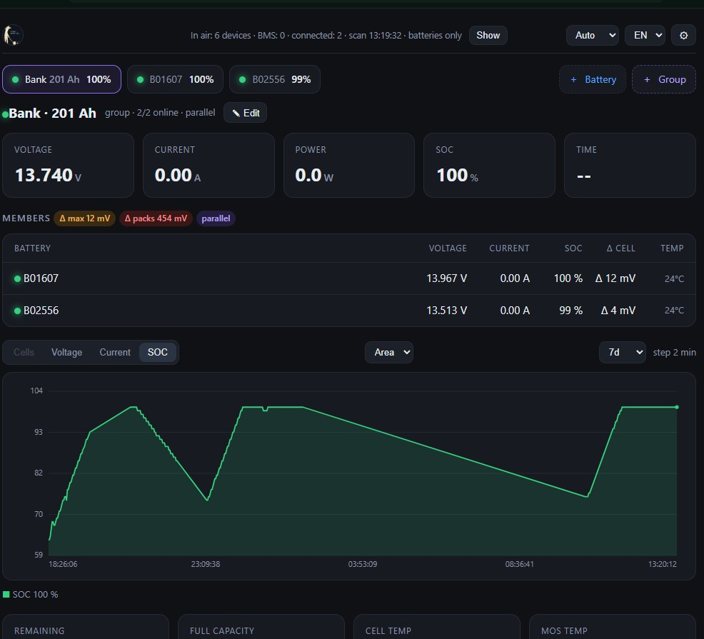

# Power Peasant — монітор батарей Power Queen, Redodo і LiTime

Неофіційний монітор для LiFePO4 SMART-батарей Power Queen, Redodo і сумісних
LiTime. Показує напруги окремих комірок — те, що офіційний застосунок парсить,
але не виводить — а також струм, потужність, SOC, температуру, час
розряду/заряду, групи та графіки.

Дані читаються напряму з BMS по Bluetooth LE; надсилається лише запит `Inquire` (`0x13`),
жодних керуючих команд.



## Можливості

- напруги всіх комірок із підсвіткою найвищої/найнижчої, розкид і стан балансування;
- напруга, струм, потужність, SOC, SOH, температури та час до розряду/заряду;
- групи батарей (паралельно/послідовно) з сумарними значеннями та ємністю;
- графіки у п'яти стилях (лінія, площа, східці, стовпці, точки) на основі CSV-історії;
  вікна 5 хв–2 роки і «Все» (відлік від останнього запису, прорідження з підписом кроку);
  протягніть мишкою, щоб наблизити довільний інтервал, Ctrl+колесо — масштаб навколо
  курсора, Shift+протягування — прокрутка, подвійний клік або ↺ — скинути;
  масштаб, що дістає до найновішого запису, слідує за новими даними, старіші
  інтервали лишаються нерухомими;
  розриви в записах показуються розривом лінії — без екстраполяції та вигаданих точок;
- список скану з історією, ручне додавання/прибирання та фільтр «лише батареї»;
- налаштування у `data/config.json` (створюється при першому старті) або через діалог ⚙;
- банер стану Bluetooth (вимкнено / немає адаптера) і діалог «Про програму»
  з логотипом, версією та посиланнями на донати з `.github/FUNDING.yml`;
- перемикач теми: авто (за системою), темна або світла;
- перевірка оновлень при старті (кеш на 24 год) і вручну з діалогу «Про програму»;
  доступний реліз відкривається на GitHub;
- інтерфейс українською, англійською та німецькою (типово англійська); без телефона й хмари.

## Підтримувані батареї

Перевірено на реальному обладнанні:

- Power Queen 12.8 В 100 Ah (`P-12100BNNA70`);
- Power Queen 12 В 140 Ah;
- Power Queen 24 В / 25.6 В 100 Ah;
- Redodo 12.8 В 280 Ah (`R-12280BNN200`);
- LiTime 12.8 В 100 Ah;
- LiTime 24 В 50 Ah;
- LiTime 12 В і 36 В.

Ймовірно сумісні, але ще не перевірені:

- інші ємності Power Queen, Redodo і LiTime на тому самому BMS;
- Starry Sea з іменами `S-…` / `SS-…`;
- збірки 36 В і 48 В.

Батареї інших брендів можуть використовувати інший Bluetooth-протокол і не
підтримуються.

Технічні деталі протоколу та правила сумісності — у [protocol.md](protocol.md).

## Вимоги

- Python **3.10+** (тестовано на 3.13)
- Bluetooth LE адаптер (Windows 10/11, Linux з BlueZ)
- Windows-збірки — **Windows 10/11 x64** (Windows 7 не підтримується)
- `pip install -r requirements.txt` (`bleak`, `pywebview`)

### Linux: підготовка

```bash
sudo apt update
sudo apt install -y python3-venv python3-pip bluez
```

## Встановлення

```bash
git clone https://github.com/moleculafree/power-peasant
cd power-peasant
python3 -m venv .venv
```

Активувати середовище:

```powershell
# Windows
.venv\Scripts\activate
```

```bash
# Linux / macOS
source .venv/bin/activate
```

```bash
pip install --upgrade pip
pip install -r requirements.txt
```

## Запуск і зупинка

### Windows (PowerShell)

```powershell
.\scripts\run.ps1 start            # у фоні, друкує URL
.\scripts\run.ps1 start -Port 8800
.\scripts\run.ps1 start -BindHost 0.0.0.0   # доступ з мережі (без авторизації!)
.\scripts\run.ps1 status
.\scripts\run.ps1 logs -Follow
.\scripts\run.ps1 restart
.\scripts\run.ps1 stop
.\scripts\run.ps1 foreground       # у цій консолі, Ctrl+C — стоп
```

Якщо PowerShell блокує скрипти, використайте обгортку:

```powershell
.\scripts\run.cmd start
.\scripts\run.cmd status
.\scripts\run.cmd stop
```

### Linux / macOS

```bash
chmod +x scripts/run.sh
./scripts/run.sh start
./scripts/run.sh start --port 8800
./scripts/run.sh start --host 0.0.0.0     # доступ з мережі (без авторизації!)
./scripts/run.sh status
./scripts/run.sh logs --follow
./scripts/run.sh stop
./scripts/run.sh foreground
```

### Прямий запуск

```bash
python scripts/pq_monitor.py --port 8791
python scripts/pq_monitor.py --window          # вбудоване вікно
python scripts/pq_monitor.py --host 0.0.0.0    # доступ з мережі (без авторизації)
```

Відкрити **http://127.0.0.1:8791/**

> За замовчуванням сервер слухає лише `127.0.0.1`. З `--host 0.0.0.0`
> (або `-BindHost 0.0.0.0` у Windows) панель доступна з інших машин — **без
> авторизації**, тому лише в довіреній мережі.

## Що показується

- напруга пакета, струм, потужність, SOC;
- орієнтовний час до розряду/заряду — одне значення за модулем струму;
- напруги комірок (mV і V), розкид max−min, стан балансування;
- найвища комірка — зелена, найнижча — помаранчева, критична (<3.05 V) — червона;
- для груп — Δ пакетів між учасниками;
- залишок/повна ємність, SOH, цикли, «віддано всього» Ah (накопичувальний
  лічильник BMS — скільки віддано за весь час роботи, під час заряду не змінюється);
- температури комірок і MOSFET, прапорці захисту/несправностей BMS.

## Скан і пристрої

Діалог скану показує зріз останнього скану (кожні 20 с): ім'я, MAC, RSSI, чи це BMS,
а також історію раніше знайдених пристроїв. Звідси можна одразу під'єднати нову батарею,
очистити історію або увімкнути фільтр **«лише батареї»**. Кнопка **«Сканувати»** (у діалозі
скану і в **«＋ Батарея»**) запускає радіоскан негайно, не чекаючи фонового циклу; додати
можна й пристрій з історії, навіть якщо він зараз не в ефірі.

Відому батарею можна прибрати з моніторингу кнопкою **«✕ Прибрати»** на її сторінці.
Ім'я потрапляє в `data/ignored.json`, тож авто-виявлення її більше не додасть; історія
в CSV лишається. Повернути — зі списку скану або кнопкою **«＋ Батарея»**.

## Групи

- назва — вільний текст (**✎ Редагувати**);
- ємність додається автоматично з під'єднаних учасників (BMS FCC) і оновлюється, коли
  батарея зникає (`100 / 201 Ah`);
- паралельно: напруга — середня, струм і ємність — сума;
- послідовно: напруга — сума, струм/ємність — за найслабшою;
- SOC групи зважений за ємністю: `Σ remaining / Σ FCC`.

## Налаштування

Файл `data/config.json` можна правити вручну або через кнопку ⚙ (зміни з панелі
застосовуються одразу; після ручної правки достатньо F5). Файл створюється при
першому старті; `assets/config.json` — лише шаблон у дистрибутиві.

| Ключ | Що задає |
|---|---|
| `ui.colors.cellMax` / `cellMin` / `cellNormal` / `cellCritical` | кольори комірок |
| `ui.colors.chartPalette` | кольори ліній графіка |
| `ui.colors.chartNegative` | колір від'ємного струму (стовпчики йдуть вниз від нуля; спільний для обох тем) |
| `ui.cells.scaleMinV` / `scaleMaxV` | межі шкали смужок |
| `ui.cells.criticalMv` | поріг «критично низька», mV |
| `ui.thresholds.cellDeltaOkMv` / `cellDeltaWarnMv` | пороги Δ комірок |
| `ui.thresholds.packSpreadOkMv` / `packSpreadBadMv` | пороги Δ пакетів у групі |
| `ui.chart.defaultWindowSec` | вікно графіка за замовчуванням, с (0 = все) |
| `ui.view.metric` / `chartStyle` / `windowSec` / `selected` | останній стан графіка й фільтрів (зберігається автоматично) |
| `ui.scan.onlyBatteries` | фільтр «лише батареї» у діалозі скану |
| `server.pollIntervalSec` | інтервал опитування BLE (після перезапуску) |
| `server.logIntervalSec` | інтервал запису CSV (після перезапуску) |
| `server.historyHours` | скільки історії підвантажувати при старті |
| `ui.about.repo` | посилання GitHub у діалозі «Про програму» |
| `ui.about.donate` | додаткове посилання для донатів (посилання з FUNDING.yml показуються завжди) |

Некоректні значення замінюються типовими; кольори — `#rgb` / `#rrggbb`.
Вибір батареї, вкладки графіка, стилю та вікна записується в `ui.view` одразу після
зміни й відновлюється після перезапуску; кожен запис сервер перевіряє читанням
файлу назад, а панель показує «Збережено» або «Не вдалося зберегти».
CLI-параметри (`--interval`, `--log-interval`, `--history-hours`) мають пріоритет.

## Структура

```
scripts/pq_monitor.py    # BLE-опитування + HTTP-сервер
assets/ui/               # панель (HTML/JS/CSS), віддається з диска
assets/config.json       # шаблон налаштувань (робоча копія: data/config.json)
data/                    # CSV-історія, config.json, групи, історія скану, логи,
                         # профіль WebView2 (gitignored)
packaging/               # збірка Windows: spec, іконка, build.ps1, BUILD.md
docs/                    # документація, скріншоти
tests/                   # unittest-тести протоколу, конфігу, груп і FUNDING.yml
```

## Тести

```bash
python -m unittest discover -s tests
```

Покривають кадри протоколу, злиття/обмеження конфігу, агрегацію груп,
розбір `FUNDING.yml` і читання `version.json`.

## Windows-застосунок

Готові збірки для Windows — на сторінці
[Releases](https://github.com/moleculafree/power-peasant/releases):

- `PowerPeasant-<версія>-win64-setup.exe` — інсталятор: за замовчуванням ставить у
  `C:\Program Files\PowerPeasant`, створює ярлики в меню «Пуск» і на робочому столі
  та деінсталятор (потрібні права адміністратора);
- `PowerPeasant-<версія>-win64.exe` — портативний архів, що саморозпаковується;
  потрапляє в реліз замість інсталятора лише тоді, коли на машині збірки не було
  NSIS: запустіть, виберіть будь-яку теку (підійде USB-флешка), далі стартуйте
  `PowerPeasant.exe`.

Збірка з вихідників: [packaging/BUILD.md](../packaging/BUILD.md). Інсталятор тримає
все у своїй теці: історія, `config.json` і кеш WebView2 лежать у `<тека
встановлення>\data` (ця підпапка стає доступною для запису під час інсталяції,
навіть у `C:\Program Files`). Лише якщо застосунок запущено з read-only теки без
такого дозволу, він переходить на `%LOCALAPPDATA%\PowerPeasant`.


## Як це працює

- PID `data/monitor.pid`; логи `data/monitor.log` (на Windows попередній — `.prev`);
- скрипти зупиняють лише процеси `pq_monitor.py`;
- батарея тримає одне BLE-з'єднання — телефонний застосунок не може бути під'єднаний
  одночасно;
- якщо батарея перестала рекламуватися, монітор усе одно пробує пряме підключення
  за MAC; кожна спроба й повний текст помилки пишуться в `data/monitor.log`, а
  причина показується в підказці рядка стану;
- останній отриманий кадр кожної батареї зберігається в `data/last_values.json`,
  тож після перезапуску офлайн-батарея лишається на панелі з останніми значеннями
  й позначкою «архів», а не порожнім екраном;
- якщо `8791` зайнятий іншим типом екземпляра (з вихідників або зібраний), застосунок
  піднімається на наступному вільному порту, а не приєднується до нього; однакові
  екземпляри відкривають спільне вікно;
- при холодному старті сплеш тримається до першого радіоскану й першого живого
  кадру (максимум 30 с; перезавантаження сторінки показує дашборд одразу), а якщо
  сервер не відповідає 10 с — з'являється діалог «Немає зв'язку»;
- історія — помісячні файли `data/<назва>-YYYY-MM.csv` (новий місяць = новий файл);
  старі однофайлові логи `data/<назва>.csv` один раз імпортуються при старті й
  перейменовуються в `*.csv.imported`; остання колонка CSV `balance` містить номери
  комірок, що балансуються (наприклад `1 3`).

## Додатково

- [Опис BLE-протоколу](protocol.md)
- [Індекс документації](README.md)
- [Головний README](../README.md)
